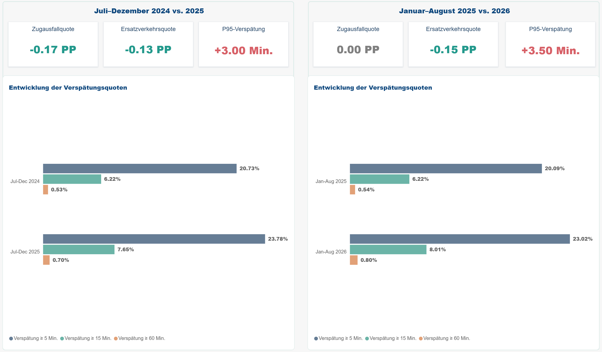

# Historischer Vergleich

## 1. Ziel der Analyse

Ziel dieser Analyse ist es, die Entwicklung wichtiger Verspätungs- und Ausfallkennzahlen über verschiedene Zeiträume zu vergleichen.

Dabei werden zwei Vergleichszeiträume betrachtet:

* **Juli–Dezember 2024 vs. Juli–Dezember 2025**

* **Januar–August 2025 vs. Januar–August 2026**

Für die Vergleiche wird dieselbe Bahnhofskohorte mit **107 Bahnhöfen** verwendet.

Die wichtigsten Vergleichskennzahlen sind:

* Median der Verspätung

* P95 der Verspätung

* Anteil ≥5 Minuten

* Anteil ≥15 Minuten

* Anteil ≥60 Minuten

* Ausfallanteil

* Anteil Ersatzverkehr

---

## 2. Vergleich Juli–Dezember 2024 vs. Juli–Dezember 2025

Für einen direkten Jahresvergleich werden jeweils die Monate Juli bis Dezember betrachtet.

| KPI           | Jul–Dez 2024 | Jul–Dez 2025 | Veränderung |

| ------------- | -----------: | -----------: | ----------: |

| Median        |       1 Min. |       1 Min. |           0 |

| P95           |      17 Min. |      20 Min. |     +3 Min. |

| ≥5 Min.       |      20,73 % |      23,78 % |    +3,05 PP |

| ≥15 Min.      |       6,22 % |       7,65 % |    +1,43 PP |

| ≥60 Min.      |       0,53 % |       0,70 % |    +0,17 PP |

| Ausfallanteil |       5,31 % |       5,14 % |    −0,17 PP |

| Ersatzverkehr |       0,70 % |       0,57 % |    −0,13 PP |

Der Median blieb unverändert bei 1 Minute.

Gleichzeitig stiegen die höheren Verspätungskennzahlen. Der Anteil der Beobachtungen mit mindestens 5 Minuten Verspätung erhöhte sich von 20,73 % auf 23,78 %. Auch bei den Schwellenwerten von 15 und 60 Minuten zeigt sich ein Anstieg.

Der Ausfallanteil und der Anteil der Ersatzverkehr-Beobachtungen entwickelten sich dagegen leicht nach unten.

Damit zeigen nicht alle Kennzahlen dieselbe Entwicklung.

---

## 3. Vergleich Januar–August 2025 vs. Januar–August 2026

Für den zweiten Vergleich werden die Monate Januar bis August betrachtet. September 2026 wurde nicht einbezogen, da für diesen Monat zum Zeitpunkt der Analyse noch keine vollständigen historischen Daten vorlagen.

| KPI           | Jan–Aug 2025 | Jan–Aug 2026 | Veränderung |

| ------------- | -----------: | -----------: | ----------: |

| Median        |       1 Min. |       1 Min. |           0 |

| P95           |    17,5 Min. |      21 Min. |   +3,5 Min. |

| ≥5 Min.       |      20,09 % |      23,02 % |    +2,93 PP |

| ≥15 Min.      |       6,22 % |       8,01 % |    +1,79 PP |

| ≥60 Min.      |       0,54 % |       0,80 % |    +0,26 PP |

| Ausfallanteil |       4,87 % |       4,87 % |        0 PP |

| Ersatzverkehr |       0,70 % |       0,55 % |    −0,15 PP |

Auch in diesem Vergleich blieb der Median bei 1 Minute.

Die höheren Verspätungskennzahlen stiegen jedoch erneut an. Der Anteil der Beobachtungen mit mindestens 5 Minuten Verspätung erhöhte sich von 20,09 % auf 23,02 %. Der Anteil ab 15 Minuten stieg von 6,22 % auf 8,01 %. Bei Verspätungen ab 60 Minuten erhöhte sich der Anteil von 0,54 % auf 0,80 %.

Der Ausfallanteil blieb dagegen mit 4,87 % in beiden Vergleichszeiträumen gleich. Der Anteil der Ersatzverkehr-Beobachtungen ging leicht zurück.

---

## 4. Zentrale Erkenntnisse

Die beiden historischen Vergleiche zeigen ein ähnliches Muster:

* Der **Median bleibt stabil bei 1 Minute**.

* Gleichzeitig steigt der **P95-Wert**.

* Der Anteil der Beobachtungen mit **≥5, ≥15 und ≥60 Minuten Verspätung** nimmt zu.

* Die Veränderungen sind damit vor allem im Bereich der stärkeren Verspätungen sichtbar.

* Der **Ausfallanteil entwickelt sich nicht parallel** zu den Verspätungskennzahlen.

* Auch der Anteil der Ersatzverkehr-Beobachtungen zeigt keine entsprechende Zunahme.

Besonders der Vergleich Januar–August 2025 mit Januar–August 2026 zeigt, dass stärkere Verspätungen häufiger beobachtet wurden, obwohl der Median unverändert blieb.

Dies deutet auf eine Veränderung vor allem im oberen Bereich der Verspätungsverteilung hin. Aus den vorliegenden Daten lässt sich jedoch nicht ableiten, welche Ursachen dafür verantwortlich sind.  

  

Dashboard in Power BI [Historical Analysis](../dashboard/historical_analysis/historical_analysis.pbix)  
[csv-Dateien](../results/historical/)  

---

## 5. Datenlimitationen

Die historischen Vergleiche müssen im Kontext der Datenverfügbarkeit betrachtet werden.

### Unterschiedliche Vergleichszeiträume

Die beiden Jahresvergleiche verwenden unterschiedliche Zeiträume:

* 2024 vs. 2025: Juli–Dezember

* 2025 vs. 2026: Januar–August

Ein direkter Vergleich der beiden Veränderungsraten über diese unterschiedlichen Zeiträume ist daher nicht vorgesehen.

### Unvollständige Daten für 2026

Für 2026 waren zum Zeitpunkt der Analyse historische Daten nur bis August verfügbar.

Außerdem fehlen in mehreren Monaten bekannte Zeiträume in den Quelldaten:

* Februar 2026: 7 Stunden

* März 2026: 10 Stunden

* April 2026: 34 Stunden

* Mai 2026: 31 Stunden

* Juni 2026: 6 Stunden

* Juli 2026: 102 Stunden

Besonders die Datenlücke im Juli ist vergleichsweise groß.

Diese fehlenden Stunden können die Anzahl und Zusammensetzung der Beobachtungen beeinflussen. Die Ergebnisse für 2026 sollten deshalb mit entsprechender Vorsicht interpretiert werden.

### Anzahl der Beobachtungen

Im Zeitraum Januar–August wurden folgende Beobachtungszahlen erfasst:

* 2025: **15.847.467**

* 2026: **15.006.492**

Die geringere Anzahl der Beobachtungen im Jahr 2026 darf nicht als Rückgang des Zugverkehrs oder der Anzahl der Zugfahrten interpretiert werden. Die Daten enthalten bekannte zeitliche Lücken.

### Analytische Einheit

Die Analyse basiert auf **Scheduled Station Events** und nicht auf eindeutig rekonstruierten physischen Zugfahrten. Deshalb beziehen sich die Kennzahlen auf beobachtete geplante Bahnhofsevents. Aussagen wie „X % der Züge waren verspätet“ werden aus diesen Daten nicht abgeleitet.  

### Keine kausalen Aussagen

Die historischen Vergleiche zeigen Veränderungen der Kennzahlen, erklären aber nicht deren Ursachen. Die Ergebnisse sind daher als **deskriptive historische Analyse** zu verstehen.  

 

## Hintergrund und mögliche Einflussfaktoren

Die Ergebnisse der historischen Analyse lassen sich besser einordnen, wenn auch betriebliche und infrastrukturelle Rahmenbedingungen des deutschen Schienenverkehrs berücksichtigt werden. Die folgenden Aspekte dienen der Kontextualisierung der Ergebnisse. Sie stellen keine direkten Nachweise für die Ursachen der in diesem Datensatz beobachteten Verspätungen dar.

### Unterschiede zwischen den Zugtypen

Die betrieblichen Rahmenbedingungen unterscheiden sich je nach Zugtyp:

- **ICE (Intercity-Express):** ICE-Züge verkehren häufig über längere Strecken und verbinden mehrere stark frequentierte Verkehrsknoten. Verspätungen auf einzelnen Streckenabschnitten können sich auf nachfolgende Verbindungen und weitere Teile des Streckennetzes auswirken.
- **IC/EC (Intercity/Eurocity):** Diese Fernverkehrszüge bedienen ebenfalls längere Strecken und teilweise mehrere Länder. Die Abhängigkeit von der Infrastruktur und von der Pünktlichkeit vorheriger Streckenabschnitte kann zu Verspätungen im weiteren Fahrtverlauf führen.
- **RE/RB (Regional-Express/Regionalbahn):** Regionalzüge bedienen häufig mehrere Zwischenstationen und verkehren teilweise in kurzen Taktabständen. Eine hohe Streckenauslastung, häufige Halte und begrenzte zeitliche Reserven im Fahrplan können die Betriebsstabilität beeinflussen.

Diese unterschiedlichen Betriebsbedingungen können zu Unterschieden in den beobachteten Verspätungskennzahlen führen. Die Ergebnisse der Analyse zeigen jedoch zunächst statistische Unterschiede und erlauben für sich genommen keine eindeutige Erklärung ihrer Ursachen.

### Infrastruktur und Baumaßnahmen

Der Zustand und die Auslastung der Schieneninfrastruktur sind wichtige Rahmenbedingungen für die Pünktlichkeit. Die Deutsche Bahn berichtet für 2025 über infrastrukturelle Störungen, umfangreiche Bauarbeiten und kurzfristige Baumaßnahmen, die zu Kapazitätseinschränkungen und zusätzlichen Verspätungen führen können.

Auch für 2026 sind umfangreiche Modernisierungs- und Sanierungsmaßnahmen im deutschen Schienennetz vorgesehen. Baustellen, eingeschränkte Streckenkapazitäten und Langsamfahrstellen können den Betriebsablauf beeinflussen.

Diese Faktoren stellen mögliche Einflussgrößen dar. Da im vorliegenden Datensatz keine vollständigen Informationen zu konkreten Baustellen, Streckensperrungen oder deren zeitlicher und räumlicher Zuordnung vorliegen, können sie nicht als nachgewiesene Ursachen der analysierten Verspätungen bewertet werden.

### Verkehrsknoten und Netzwerkeffekte

Große Verkehrsknoten wie Frankfurt am Main, Mannheim, Köln und Hamburg weisen eine komplexe und hoch frequentierte Verkehrsstruktur auf. Dort treffen unterschiedliche Zugverbindungen und Verkehrsströme aufeinander. Eine hohe Auslastung der Infrastruktur kann die betriebliche Stabilität beeinträchtigen.

In diesem Zusammenhang sind **Netzwerkeffekte und Verspätungsübertragung** von Bedeutung. Eine Verspätung kann sich nicht nur auf einen einzelnen Zug oder Bahnhof beschränken, sondern unter bestimmten Bedingungen auf nachfolgende Verbindungen und weitere Streckenabschnitte übertragen werden. Dadurch können auch Bahnhöfe betroffen sein, an denen die ursprüngliche Störung nicht aufgetreten ist.

Die Deutsche Bahn beschreibt in ihren Berichten die hohe Auslastung zentraler Verkehrsknoten und die Übertragung von Verspätungen in das weitere Streckennetz als relevante Herausforderungen für die Pünktlichkeit.

### Quellen

- Deutsche Bahn: [Integrierter Zwischenbericht 2025 – Pünktlichkeit](https://zbir.deutschebahn.com/2025/de/konzern-zwischenlagebericht-ungeprueft/qualitaet-und-sicherheit/puenktlichkeit/)
- Deutsche Bahn: [Geschäftsbericht 2025 – Entwicklung im Berichtsjahr](https://ibir.deutschebahn.com/2025/de/zusammengefasster-lagebericht/entwicklung-der-geschaeftsfelder/geschaeftsfeld-db-regio/entwicklung-im-berichtsjahr/)
- Deutsche Bahn: [Geschäftsbericht 2025 – Wesentliche nichtfinanzielle Kennzahlen](https://ibir.deutschebahn.com/2025/de/zusammengefasster-lagebericht/strategie/wesentliche-nichtfinanzielle-kennzahlen/)

