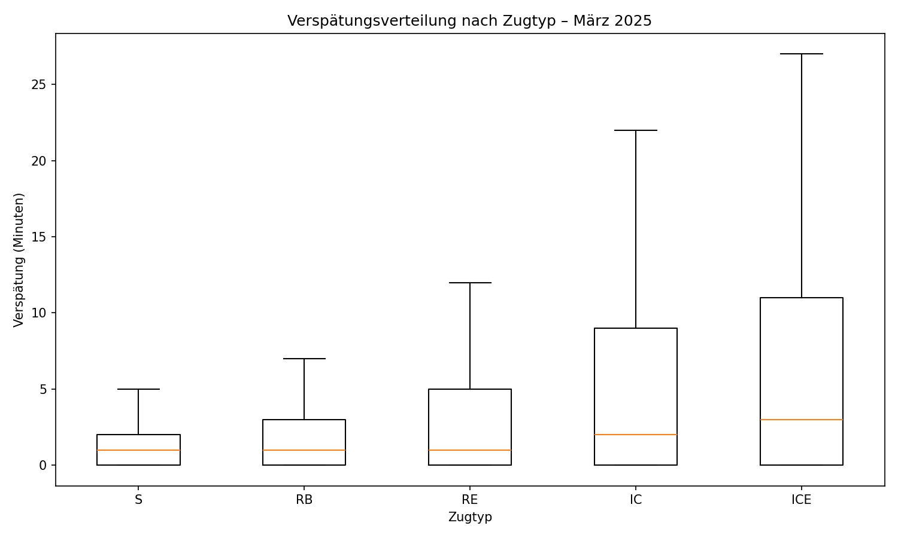
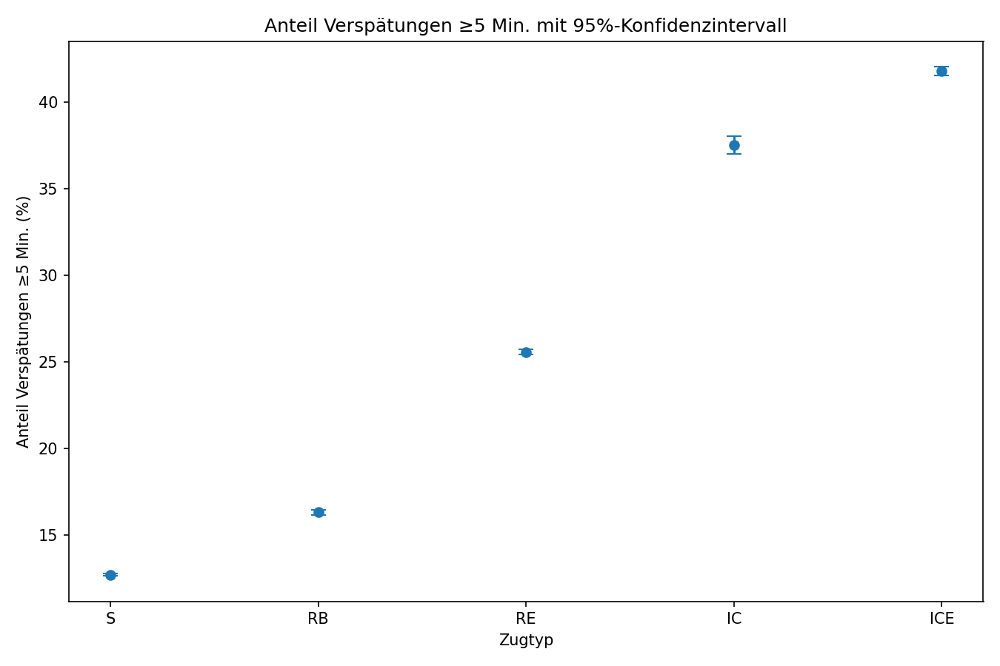
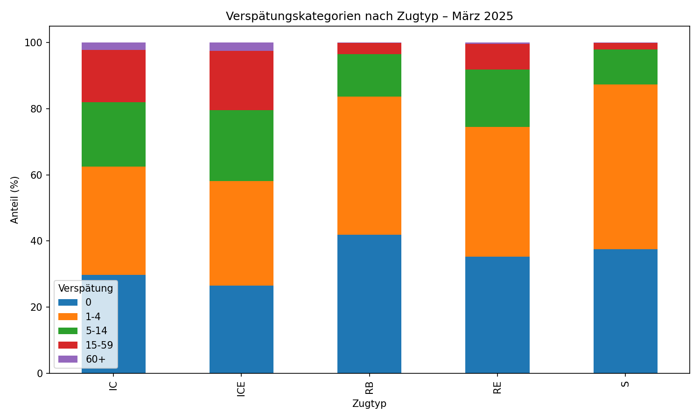
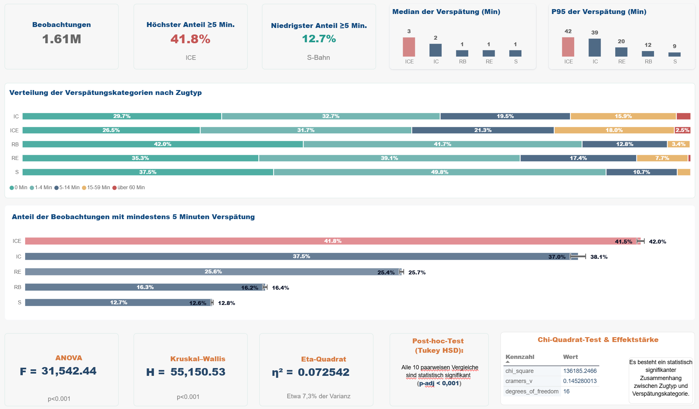

# Statistische Analyse – Zugtyp und Verspätungen

## Ziel der Analyse

In diesem Schritt wurde untersucht, ob sich Zugtypen hinsichtlich ihrer Verspätungen statistisch unterscheiden.

Betrachtet wurden die fünf wichtigsten Zugtypen:

* S

* RB

* RE

* IC

* ICE

Die Analyse basiert auf den historischen DB-Daten für **März 2025**.

Für die statistischen Tests wurden negative Werte von `delay_in_min` ausgeschlossen. Dadurch wurden 1.613.089 Beobachtungen analysiert.

Negative Werte wurden nicht aus den Rohdaten entfernt. Sie wurden nur für diese statistische Analyse ausgeschlossen, weil sehr große negative Werte die Verspätungsverteilung stark beeinflussen können.

---

## Warum wurden diese Methoden verwendet?

Für die Analyse wurden mehrere Methoden kombiniert. Sie beantworten unterschiedliche Fragen.

### 1. Deskriptive Statistik

Zuerst wurden Median, Mittelwert, Standardabweichung, Quartile, IQR und P95 berechnet.

Damit lässt sich zunächst beschreiben:

* Wie hoch ist eine typische Verspätung?

* Wie stark streuen die Werte?

* Wie groß sind stärkere Verspätungen?

Der **Median** wurde besonders berücksichtigt, weil Verspätungsdaten nicht symmetrisch verteilt sind und einzelne sehr hohe Werte vorkommen können.

---

### 2. One-way ANOVA

Mit der One-way ANOVA wurde geprüft, ob sich die **mittleren Verspätungen zwischen den fünf Zugtypen** statistisch unterscheiden.

Die Nullhypothese lautet:

> Die mittleren Verspätungen aller Zugtypen sind gleich.

Ergebnis:

* F-Statistik: **31.542,44**

* p < 0,001

Die Nullhypothese wird verworfen.

Damit gibt es statistisch signifikante Unterschiede zwischen den Zugtypen.

Bei der Interpretation wurde jedoch nicht nur der p-Wert betrachtet, weil bei mehr als 1,6 Millionen Beobachtungen auch kleine Unterschiede sehr leicht statistisch signifikant werden.

---

### 3. Kruskal-Wallis-Test

Zusätzlich wurde der Kruskal-Wallis-Test verwendet.

Dieser Test ist für diese Daten sinnvoll, weil Verspätungen nicht normalverteilt sind und eine deutliche Schiefe aufweisen.

Der Test prüft, ob sich die Verteilungen der Verspätungen zwischen den Gruppen unterscheiden.

Ergebnis:

* H-Statistik: **55.150,53**

* p < 0,001

Auch dieser Test zeigt deutliche statistische Unterschiede zwischen den Zugtypen.

Die Ergebnisse von ANOVA und Kruskal-Wallis führen damit zum gleichen allgemeinen Ergebnis.

---

### 4. Effektgröße: Eta Squared

Zusätzlich zur statistischen Signifikanz wurde die Effektgröße berechnet.

Ergebnis:

**η² = 0,0725**

Damit werden etwa **7,25 % der Varianz der analysierten Verspätungswerte durch die Gruppierung nach Zugtyp erklärt**.

Diese Kennzahl ist wichtig, weil sie zeigt, dass die Unterschiede nicht nur aufgrund der sehr großen Stichprobe statistisch signifikant sind.

Gleichzeitig bedeutet der Wert auch, dass der Zugtyp nur einen Teil der Unterschiede erklärt. Weitere Faktoren spielen ebenfalls eine Rolle.

---

### 5. Post-hoc-Analyse: Tukey HSD

Nach der ANOVA wurde der **Tukey-HSD-Test (Honestly Significant Difference)** durchgeführt.

Die ANOVA zeigt, ob es insgesamt statistisch signifikante Unterschiede zwischen den Gruppen gibt. Sie zeigt jedoch nicht, **zwischen welchen Zugtypen** diese Unterschiede bestehen.

Der Tukey-HSD-Test ermöglicht deshalb einen paarweisen Vergleich aller fünf Zugtypen. Dabei werden die Mittelwerte der einzelnen Gruppen miteinander verglichen und die Ergebnisse für multiple Vergleiche korrigiert. Dadurch wird das Risiko reduziert, zufällig signifikante Unterschiede zu finden.

#### Ergebnisse der paarweisen Vergleiche

Alle zehn möglichen Paarvergleiche waren statistisch signifikant (p-adj < 0,001). Die Konfidenzintervalle aller Vergleiche schließen den Wert 0 nicht ein. Damit unterscheiden sich die mittleren Verspätungen aller fünf Zugtypen statistisch signifikant voneinander.

| Vergleich | Mittlere Differenz (Min.) |
|---|---:|
| IC – ICE | +1,20 |
| IC – RB | −5,88 |
| IC – RE | −4,06 |
| IC – S | −6,38 |
| ICE – RB | −7,08 |
| ICE – RE | −5,25 |
| ICE – S | −7,58 |
| RB – RE | +1,82 |
| RB – S | −0,51 |
| RE – S | −2,33 |

Die größten Unterschiede zeigen sich zwischen **ICE und S-Bahn (S)** sowie zwischen **ICE und Regionalbahn (RB)**.  

- **ICE – S-Bahn:** Die mittlere Verspätung der ICE-Züge liegt um etwa 7,58 Minuten höher als die der S-Bahn. Das 95%-Konfidenzintervall liegt zwischen 7,52 und 7,64 Minuten. Dies weist auf einen deutlichen und statistisch signifikanten Unterschied zwischen beiden Zugtypen hin.  

- **ICE – Regionalbahn (RB):** Die mittlere Verspätung der ICE-Züge liegt um etwa 7,08 Minuten höher als die der Regionalbahn. Auch hier zeigt das Konfidenzintervall (7,00 bis 7,15 Minuten) einen statistisch signifikanten Unterschied.  

Ein weiterer interessanter Vergleich ist **IC – ICE**. Obwohl sich beide Zugtypen im Fernverkehr befinden, beträgt die mittlere Differenz nur etwa 1,20 Minuten. Der Unterschied ist statistisch signifikant, aber deutlich kleiner als bei den Vergleichen zwischen Fern- und Regionalverkehr.  

Die kleinste mittlere Differenz zeigt sich zwischen **RB und S-Bahn** mit etwa 0,51 Minuten. Auch dieser Unterschied ist statistisch signifikant.  

Die Ergebnisse zeigen, dass sich die mittleren Verspätungen zwischen allen fünf untersuchten Zugtypen statistisch signifikant unterscheiden. Besonders große Unterschiede bestehen zwischen dem Fernverkehr (ICE, IC) und dem Regionalverkehr (RB, RE, S).  

Es ist jedoch wichtig zu beachten, dass **statistische Signifikanz nicht automatisch praktische Relevanz bedeutet**. Bei einer sehr großen Stichprobe können auch kleine Unterschiede statistisch signifikant sein.  

Die Ergebnisse zeigen einen statistischen Zusammenhang zwischen Zugtyp und Verspätung. Sie beweisen jedoch nicht, dass der Zugtyp selbst die Ursache für die unterschiedlichen Verspätungen ist.  

---

## Ergebnisse der deskriptiven Statistik

| Zugtyp | Beobachtungen | Median | Mittelwert | Q1 | Q3 | IQR | P95 |

| ------ | ------------: | -----: | ---------: | -: | -: | --: | --: |

| S      |       816.845 |      1 |       2,18 |  0 |  2 |   2 |   9 |

| RB     |       264.043 |      1 |       2,68 |  0 |  3 |   3 |  12 |

| RE     |       345.966 |      1 |       4,50 |  0 |  5 |   5 |  20 |

| IC     |        33.614 |      2 |       8,56 |  0 |  9 |   9 |  39 |

| ICE    |       152.621 |      3 |       9,76 |  0 | 11 |  11 |  42 |

Die Medianwerte zeigen relativ kleine typische Verspätungen.

Deutlich größer sind die Unterschiede bei stärkeren Verspätungen. Der P95 liegt beispielsweise bei:

* **9 Minuten für S**

* **12 Minuten für RB**

* **20 Minuten für RE**

* **39 Minuten für IC**

* **42 Minuten für ICE**

Das zeigt, dass sich die Zugtypen vor allem bei den stärkeren Verspätungen unterscheiden.

### Abbildung: Verteilung der Verspätungen nach Zugtyp

---

## Anteil der Verspätungen ab 5 Minuten

Zusätzlich wurde eine einfach verständliche Schwelle von **mindestens 5 Minuten Verspätung** betrachtet.

| Zugtyp | ≥5 Minuten |        95%-KI |

| ------ | ---------: | ------------: |

| S      |    12,70 % | 12,63–12,77 % |

| RB     |    16,29 % | 16,15–16,43 % |

| RE     |    25,56 % | 25,42–25,71 % |

| IC     |    37,54 % | 37,02–38,06 % |

| ICE    |    41,80 % | 41,55–42,04 % |

Die Anteile unterscheiden sich deutlich.

Der Anteil von Beobachtungen mit mindestens fünf Minuten Verspätung reicht von **12,70 % bei S** bis **41,80 % bei ICE**.

Die Konfidenzintervalle sind aufgrund der großen Stichproben relativ eng. Dadurch sind die geschätzten Anteile statistisch sehr präzise.

### Abbildung: Anteil der Verspätungen ≥5 Minuten

---

## Zusammenhang zwischen Zugtyp und Verspätungskategorie

Neben der numerischen Verspätung wurden die Beobachtungen auch in Verspätungskategorien eingeteilt.

Dafür wurde ein Chi-Quadrat-Test durchgeführt.

Ergebnis:

* χ² = **136.185,25**

* Freiheitsgrade = **16**

* p < 0,001

* Cramér's V = **0,1453**

Der Test zeigt einen statistisch signifikanten Zusammenhang zwischen dem Zugtyp und der Verteilung der Verspätungskategorien.

Cramér's V zeigt gleichzeitig, dass der Zusammenhang nicht sehr stark ist. Der Zugtyp ist daher ein relevanter Faktor, erklärt aber nicht allein die Verspätung.

Im Power-BI-Dashboard wird diese Verteilung zusätzlich als prozentuale Anteile
je Zugtyp visualisiert.

### Abbildung: Verspätungskategorien nach Zugtyp

---

# Zentrale Ergebnisse

Die statistische Analyse zeigt fünf wichtige Punkte:

1. **Die Verspätungen unterscheiden sich statistisch zwischen den betrachteten Zugtypen.**

  Dies wird sowohl durch die ANOVA als auch durch den Kruskal-Wallis-Test bestätigt.

2. **Die Unterschiede sind besonders bei stärkeren Verspätungen sichtbar.**

  Der Median liegt zwischen 1 und 3 Minuten, während sich die P95-Werte deutlich stärker unterscheiden.

3. **ICE und IC zeigen in dieser Stichprobe höhere Verspätungswerte als S, RB und RE.**

  Beim Anteil der Beobachtungen mit mindestens fünf Minuten Verspätung liegen ICE und IC ebenfalls deutlich höher.

4. **Der Zugtyp erklärt einen Teil, aber nicht die gesamte Variation der Verspätungen.**

  Die Effektgröße η² beträgt 0,0725. Weitere Einflussfaktoren müssen daher ebenfalls berücksichtigt werden.

5. **Auch die Verteilung der Verspätungskategorien hängt statistisch mit dem Zugtyp zusammen.**

  Der Chi-Quadrat-Test ist signifikant, Cramér's V beträgt 0,1453.

---

## Was die Analyse nicht zeigt

Die Ergebnisse zeigen **Zusammenhänge, keine Kausalität**.

Aus den Daten kann beispielsweise nicht geschlossen werden, dass ein bestimmter Zugtyp selbst die Ursache für höhere Verspätungen ist.

Mögliche weitere Einflussfaktoren sind zum Beispiel:

* Tageszeit

* Wochentag

* Bahnhof

* Strecke

* Verkehrsaufkommen

* betriebliche Störungen

* Wetter

* Baustellen oder Infrastrukturprobleme

Diese Faktoren werden deshalb in weiteren Teilen des Projekts separat untersucht.

---

## Methodische Einschränkungen

### Negative Verspätungswerte

Für die statistischen Tests wurden negative Werte ausgeschlossen. Die Rohdaten wurden dadurch nicht verändert.

### Große Stichprobe

Mit mehr als 1,6 Millionen Beobachtungen werden auch relativ kleine Unterschiede sehr schnell statistisch signifikant.

Deshalb wurden neben p-Werten auch Effektgrößen und Konfidenzintervalle betrachtet.

### Unterschiedliche Zugtypen

Die Zugtypen unterscheiden sich in ihrer Funktion und ihrem Betriebsmodell. Ein direkter Vergleich ist daher eine statistische Beschreibung der beobachteten Daten und keine Bewertung der betrieblichen Qualität eines Zugtyps.

### Keine Kausalanalyse

Die Analyse untersucht Zusammenhänge zwischen Zugtyp und Verspätungen. Sie ist nicht dafür geeignet, kausale Ursachen für Verspätungen zu bestimmen.  

### Visualisierung statistischer Analysen 
 

    

Dashboard in Power BI [Historical Analysis](../dashboard/historical_analysis/historical_analysis.pbix)    

## Reproduzierbarkeit  

Die Analyse kann mithilfe der folgenden Skripte nachvollzogen und reproduziert werden:  

- [Python-Skript – Statistische Analyse](../src/analyze_statistical_tests.py)  
- [SQL-Abfrage – Datenextraktion](../sql/statistical_analysis.sql)  
- [csv-Dateien](../results/statistical_analysis/)    

---

## Fazit

Die statistische Analyse bestätigt die Ergebnisse der vorherigen explorativen Analyse:

**Der Zugtyp steht in einem deutlichen statistischen Zusammenhang mit der Höhe und der Kategorie der beobachteten Verspätungen. Die Unterschiede werden besonders bei stärkeren Verspätungen sichtbar. Gleichzeitig erklärt der Zugtyp nur einen Teil der Gesamtvariation, sodass weitere Faktoren wie Bahnhof und Tageszeit berücksichtigt werden müssen.**

Damit liefert die Analyse eine statistische Grundlage für die weiteren Untersuchungen im Projekt.
