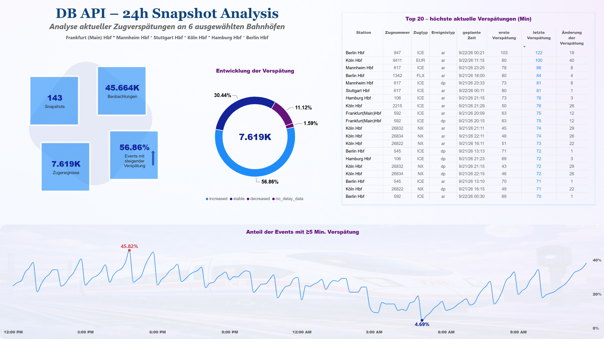

# Tägliche Analyse der DB API

## Ziel

Analyse einer 24-stündigen Sammlung von DB-API-Snapshots, um die Datenqualität zu untersuchen und Veränderungen der von der API angezeigten Verspätungen derselben Zugereignisse im Zeitverlauf zu analysieren.

Die Untersuchung besteht aus zwei Teilen:

1. **Snapshot-Qualitätsanalyse:** Bewertung der Vollständigkeit, Datenstruktur, Zeitstempel und weiteren Qualitätsmerkmalen der erfassten API-Daten.
2. **Analyse der Ereignisentwicklung:** Untersuchung, wie sich die angezeigten Verspätungen identifizierbarer Zugereignisse zwischen mehreren Snapshots verändern.

## Datensammlung

- Erwarteter Erhebungszeitraum: 24 Stunden
- Erwartetes Intervall: 10 Minuten
- Erwartete Anzahl: 144 Snapshots
- Tatsächlich verfügbare Snapshots: 143
- Ausgewählte Bahnhöfe: 6
- Gesamtzahl der Beobachtungen: 45.664

Die Datenerhebung weist eine Lücke von einem Snapshot auf. Zusätzlich fehlt Hamburg Hbf im Zeitraum zwischen 02:00 und 03:50 Uhr.

Die Analyse basiert auf den tatsächlich verfügbaren Snapshot-Dateien. Fehlende Snapshots werden nicht interpoliert oder durch geschätzte Werte ersetzt.

## Datenqualität und Snapshot-Analyse

Die Datenqualität wird anhand verschiedener Kriterien untersucht:

- Vollständigkeit der Snapshot-Erhebung
- Stationsabdeckung innerhalb der einzelnen Snapshots
- Anzahl der Beobachtungen und erfassten Zugereignisse
- Fehlende und negative Verspätungswerte
- Verteilung der Verspätungswerte
- Häufigkeit der Event Types
- Doppelte Beobachtungen innerhalb eines Snapshots
- Plausibilität und interne Konsistenz der Zeitangaben

### Einheit der Analyse

Die Qualitätskennzahlen der Snapshot-Analyse beziehen sich grundsätzlich auf einzelne **API-Beobachtungen innerhalb eines Snapshots**.

Dasselbe Zugereignis kann in mehreren Snapshots vorkommen. Daher sind die Beobachtungen nicht mit der Anzahl eindeutiger Zugfahrten oder Zugereignisse gleichzusetzen.

### Verteilung der Verspätungswerte

Die Verteilung der `delay_minutes` basiert auf allen verfügbaren, nicht fehlenden Verspätungswerten aus den Snapshots.

Ein Zugereignis kann mehrfach in die Verteilung eingehen, wenn es in mehreren Snapshots erfasst wurde.

Negative Werte werden beibehalten, da sie eine Abweichung vom Fahrplan in Form einer früheren Ankunft oder Abfahrt darstellen können. Die Verteilung umfasst somit sowohl positive als auch negative Abweichungen.

Fehlende `delay_minutes`-Werte werden bei der Berechnung der Verteilungskennzahlen ausgeschlossen.

### Ereignistypen

Die Event-Type-Auswertung basiert auf der Häufigkeit der Ereignistypen in den verfügbaren Snapshot-Beobachtungen.

Ein Ereignis kann in mehreren Snapshots auftreten und entsprechend mehrfach gezählt werden. Die Ergebnisse beschreiben daher die Häufigkeit der Event Types innerhalb der API-Beobachtungen und nicht die Anzahl eindeutiger Ereignisse im gesamten Erhebungszeitraum.

### Validierung der Zeitangaben

Zur Plausibilitätsprüfung wird die Differenz zwischen `changed_time` und `planned_time` mit dem Wert `delay_minutes` verglichen.

Abweichungen von mehr als einer Minute werden als Inkonsistenzen erfasst.

Diese Prüfung bewertet die interne rechnerische Übereinstimmung der Zeitangaben. Sie stellt keine unabhängige Überprüfung der tatsächlichen Fahrplan- oder Echtzeitdaten dar.

## Identifikation der Zugereignisse

Für die Analyse der zeitlichen Entwicklung wird ein Zugereignis anhand folgender Felder identifiziert:

`station_eva + stop_id + train_number + planned_time + event_type`

Die geplante Zeit wird vor der Bildung des Schlüssels in ein einheitliches Datums- und Zeitformat umgewandelt.

Dadurch kann dasselbe Zugereignis in mehreren Snapshots wiedererkannt werden, auch wenn sich seine angezeigte Verspätung im Laufe der Erhebung verändert.

Die Analyse berücksichtigt Zugereignisse, die in mindestens zwei Snapshots beobachtet wurden.

Doppelte Kombinationen aus Zugereignis und Snapshot-Zeitpunkt werden überprüft. Falls solche Duplikate auftreten, wird die Analyse abgebrochen, damit mögliche Datenprobleme nicht durch eine automatische Entfernung von Zeilen verdeckt werden.

## Entwicklung der Verspätung

Für jedes identifizierte Zugereignis werden die erste und die letzte verfügbare Verspätungsbeobachtung betrachtet.

Die Veränderung wird folgendermaßen berechnet:

`delay_change = last_delay - first_delay`

Dabei gilt:

- `first_delay`: erster verfügbarer, nicht fehlender `delay_minutes`-Wert
- `last_delay`: letzter verfügbarer, nicht fehlender `delay_minutes`-Wert
- `delay_change`: Differenz zwischen der letzten und der ersten verfügbaren Verspätung

Negative Verspätungswerte werden auch in dieser Analyse beibehalten.

### Klassifizierung der Ereignisentwicklung

Ein Zugereignis wird anhand der Veränderung seiner Verspätung einer der folgenden Kategorien zugeordnet:

| Kategorie | Definition |
|---|---|
| `increased` | Die letzte Verspätung ist höher als die erste. |
| `decreased` | Die letzte Verspätung ist niedriger als die erste. |
| `stable` | Die erste und die letzte Verspätung sind gleich. |
| `no_delay_data` | Weniger als zwei gültige Verspätungsbeobachtungen liegen vor. |

**Wichtig:** Für die Klassifizierung als `increased`, `decreased` oder `stable` müssen mindestens zwei nicht fehlende Verspätungsbeobachtungen aus unterschiedlichen Snapshots vorliegen.

Ein Ereignis mit nur einer gültigen Verspätungsbeobachtung wird nicht als `stable` klassifiziert, da keine tatsächliche Veränderung über die Zeit festgestellt werden kann.

`no_delay_data` bedeutet, dass keine ausreichende Datengrundlage für die Analyse der Verspätungsentwicklung vorlag. Es bedeutet nicht, dass keine Verspätung vorhanden war.

### Ergebnisse der Ereignisentwicklung

| Kategorie | Zugereignisse | Anteil |
|---|---:|---:|
| `increased` | 4.332 | 56,86 % |
| `decreased` | 847 | 11,12 % |
| `stable` | 2.319 | 30,44 % |
| `no_delay_data` | 121 | 1,59 % |
| **Gesamt** | **7.619** | **100 %** |

Die Klassifizierung umfasst insgesamt 7.619 Zugereignisse.

Die Ergebnisse zeigen, dass sich die von der API angezeigte Verspätung eines Zugereignisses zwischen der ersten und der letzten verfügbaren Beobachtung verändern kann.

Die größten positiven und negativen Veränderungen können anhand der Spalte `delay_change` untersucht werden.

## Einschränkungen der Analyse

- Die API-Analyse umfasst nur sechs ausgewählte Bahnhöfe.
- Die Erhebung weist einen fehlenden Snapshot sowie eine zeitliche Lücke bei der Stationsabdeckung von Hamburg Hbf auf.
- Die Ergebnisse basieren auf den tatsächlich verfügbaren API-Daten und nicht auf einer vollständig lückenlosen Erhebung.
- Ein Zugereignis kann in mehreren Snapshots vorkommen. Die Qualitätskennzahlen und Verteilungen basieren daher teilweise auf wiederholten Beobachtungen desselben Ereignisses.
- Die Ereignisentwicklung basiert auf der ersten und letzten verfügbaren Verspätungsbeobachtung. Zwischenzeitliche Veränderungen werden bei dieser Kennzahl nicht vollständig abgebildet.
- Wenn ein Zugereignis in einem späteren Snapshot nicht mehr vorhanden ist, bedeutet das nicht automatisch, dass der Zug ausgefallen ist.
- `no_delay_data` weist auf eine unzureichende Datengrundlage für die Klassifizierung hin und ist nicht mit einer Verspätung von null gleichzusetzen.
- Die Zeitstempelvalidierung überprüft die interne Konsistenz der Daten, nicht deren unabhängige Richtigkeit.
- Die Analyse beschreibt Veränderungen der angezeigten Verspätungen und mögliche Zusammenhänge. Sie erlaubt keine Aussagen über kausale Zusammenhänge.

## Ergebnisse und erzeugte Dateien

Die Python-Auswertungen erzeugen CSV-Dateien mit Informationen zu:

- Snapshot-Qualität und Vollständigkeit der Erhebung
- Stationsabdeckung
- Zeitstempel-Qualität und Plausibilitätsprüfungen
- Verteilung der Verspätungswerte
- Häufigkeit der Event Types
- Entwicklung der identifizierten Zugereignisse
- Veränderung der Verspätungen zwischen der ersten und letzten verfügbaren Beobachtung
- Klassifizierung der Ereignisentwicklung

Die Ergebnisse werden im Verzeichnis `results/api_day/` gespeichert.

## Power BI Dashboard

Die Ergebnisse der 24-stündigen Snapshot-Analyse wurden in einem interaktiven Power-BI-Dashboard visualisiert.

[Dashboard in Power BI](../dashboard/api_day_analysis/api_day_analysis.pbix)

[Python-Skripte](../src/)

[CSV-Dateien](../results/api_day/)

### Inhalte des Dashboards

Das Dashboard zeigt:

- **143 verfügbare Snapshots** innerhalb des untersuchten Zeitraums
- **45.664 API-Beobachtungen**
- **7.619 identifizierte Zugereignisse**
- Die Entwicklung der Snapshot-Qualität und Datenvollständigkeit
- Den zeitlichen Verlauf des Anteils der Ereignisse mit einer Verspätung von mindestens 5 Minuten
- Die Verteilung der Zugereignisse auf die Kategorien `increased`, `decreased`, `stable` und `no_delay_data`
- Die **20 Zugereignisse mit steigender Verspätung und den höchsten zuletzt verfügbaren Verspätungswerten** (`last_delay`)

Die Auswahl der 20 Zugereignisse erfolgt anhand der Kategorie `increased`. Innerhalb dieser Gruppe werden die Ereignisse nach `last_delay` absteigend sortiert. Bei gleichen Werten wird zusätzlich `event_key` absteigend berücksichtigt.

Die dargestellten Ereignisse zeigen somit nicht die größten Veränderungen der Verspätung (`delay_change`), sondern die höchsten zuletzt verfügbaren Verspätungswerte unter den Ereignissen mit steigender Versпätung.